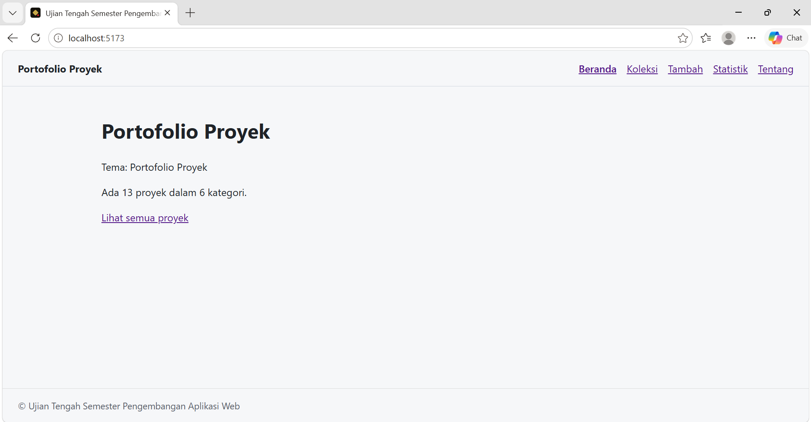

# Portofolio Proyek

- **Nama:** Jova Pratama Nihanda
- **NIM:** 124140019
- **Kelas:** RA
- **Tema:** Portofolio Proyek
- **Deployment:** https://eagleeyes-cyber.github.io/uts-paw/



Aplikasi React untuk mendata proyek pribadi (judul, kategori, teknologi, tahun, tautan).

## Fitur

- Beranda dengan ringkasan jumlah proyek dan kategori
- Daftar proyek (`/koleksi`) dimuat dengan `fetch`, dilengkapi pencarian judul
- Detail proyek (`/koleksi/:id`) dengan field Teknologi, Tahun, dan Tautan, serta tombol Hapus
- Form tambah proyek (`/tambah`) dengan validasi judul, disimpan ke localStorage
- Statistik jumlah proyek per kategori dalam tabel (`/statistik`)
- Halaman Tentang dan halaman 404

## Menjalankan secara lokal

```bash
cd app
npm install
npm run dev
```

## Konsep React yang dipakai

- `useState` dan `useEffect`
- Context API dan custom hook
- React Router
- Komponen terpisah di `src/components`
- Vitest + Testing Library
